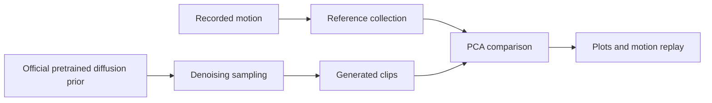

# Humanoid Spinkick: What PCA Reveals About a Frozen SMP Prior

**English source edition.** [中文译本](analysis.zh-CN.md) · [Experiment record and playback commands](reproduce.md)

A motion recording is a sequence of body poses. This report compares an official recorded kick with 512 short clips produced by an already trained motion generator. PCA provides a common way to inspect what varies, what a few components can recover, and how generated samples relate to the recording. It also examines intermediate estimates made while the generator removes noise.

The intended reader knows basic PCA but may be new to motion data, probability and machine learning. Start with the reader guide, then use G01–G02 for compression, G08–G09 for distributions and G10–G11 for denoising. The GIFs connect those measurements to visible poses. Sections 6–7 retain decoding and implementation details for later inspection.

## Reader guide

### A. A pose, a clip and a moving skeleton

The Humanoid is an articulated skeleton: connected rigid bodies with joints. A **pose** describes the body at one instant; a **motion clip** is a time-ordered sequence of poses. The player reads numerical joint coordinates, uses the skeleton to compute body positions, and draws the result. It is not playing a camera video.

A **degree of freedom (DOF)** is an independent coordinate allowed by a joint. A knee hinge has one angular DOF; a ball-like joint needs three rotation coordinates. This asset has 28 local DOFs. Its **root** additionally describes the whole body's position and orientation. Moving the root moves the character as a whole; changing local DOFs changes its posture. **Forward kinematics (FK)** turns root and joint coordinates into body positions using known bone connections and lengths. This geometric calculation does not test whether a character could balance or produce the required forces.

The native motion format stores those coordinates directly. FPS means frames per second. In this report, a ten-frame generated clip is only a short part of an action, not a complete kick. Pose PCA compares individual poses; window PCA also retains their local order within a short sequence.

### B. Observed points, distributions and probability density

Imagine collecting the right-knee angle from every frame. A histogram shows which ranges occur often. Keeping knee and hip angles instead gives one point per frame in a two-dimensional plane. Our scatter plots use two PCA coefficients rather than two named joint angles, so they summarize more of the body's variation.

A **distribution** describes how observations or samples occupy this space. For a finite collection, the empirical probability of a region is its fraction of sampled points. A **density estimate** replaces the discrete points with a smooth surface. Probability is the integral over a region, not the height at one exact pose. This also explains why a probability-density axis has units.

Three objects must remain separate: the observed finite dataset, the high-dimensional distribution represented by the learned generator, and the low-dimensional Gaussian/KDE estimate drawn from projected samples. The plots show the third object alongside the first. They do not directly evaluate the generator's full probability density. A slow part of a recorded motion can contribute many similar frames; a dense area therefore need not indicate better motion.

### C. ML, DL, RL and a motion prior

**Machine learning (ML)** learns patterns or model parameters from examples. **Deep learning (DL)** uses neural networks with multiple learned layers; the motion generator here is such a model. PCA also fits a representation from data, but this tool computes it directly by singular value decomposition (SVD), a matrix factorization, rather than training a neural network. **Reinforcement learning (RL)** learns a decision rule through interaction and reward. RL can use deep networks; it is not a mandatory next stage after DL. These distinctions follow the introductory treatments in the [Deep Learning textbook](https://www.deeplearningbook.org/contents/intro.html) and [Sutton and Barto's RL textbook](https://mitpress.ublish.com/book/reinforcement-learning-an-introduction-2).

A **policy** maps observations of a simulated character to control actions. Its actions influence the next state through physics. A **motion prior** encodes motion patterns learned from examples and can guide what movements should be preferred. **Frozen** means its learned parameters are held fixed. Here an official checkpoint, a file of previously learned parameters, is loaded for sampling; its parameters are not trained again.

### D. Diffusion generation and the SMP connection

During diffusion-model training, clean examples are corrupted with different amounts of noise and a network learns denoising predictions. At generation time, new random noise is repeatedly updated into a structured sample. It is not necessary to start from a particular recorded clip and recover that same clip. The 50 denoising steps in this case are inference steps, not training epochs. This is the basic distinction between training and sampling in [DDPM](https://arxiv.org/abs/2006.11239).

**SMP means Score-Matching Motion Priors.** Its framework uses a frozen diffusion model to construct a motion-imitation reward through score distillation sampling (SDS), then trains a control policy with that reward. In this case we inspect direct samples from the prior, not that policy. See the [SMP paper](https://arxiv.org/abs/2512.03028).

The statistical **score** is a vector, $s_t(x)=\nabla_x\log p_t(x)$: it describes the local direction in which a noisy-motion density increases. Here x is the motion-feature vector, $p_t$ the noisy-motion density at level t, and $\nabla_x$ the vector of derivatives with respect to those coordinates. It is different from a **PCA score**, which is a coordinate along a principal component. Our figures use PCA scores; they do not plot the SMP reward or the diffusion score field.



The report uses three distinct operations: **sampling** produces a clip with the generator; **decoding** converts generated features into native motion coordinates; **PCA reconstruction** approximates an existing clip from selected components. The density surfaces are a separate visualization step after PCA projection.

## Findings at a glance

The main findings are:

- Pose PCA has similar compression curves for the reference and generated collections. At K=3, the retained variance is 77.06% and 77.49%, respectively.
- Window PCA separates the collections more clearly. The reference has only 30 windows and a numerical rank of 29; the generated collection has 512 windows and a rank of 280. These ranks describe this dataset and representation, not a quality score.
- The final generated poses mostly follow the reference trajectory in its first two PCA coordinates. Early clean estimates at diffusion timestep 49 are much more dispersed. Neither observation establishes physical validity or coverage of the full motion distribution.

These results concern direct samples from a frozen prior. No training, control-policy execution or remote operation was performed. This report is an exploratory case study, not an independent evaluation of SMP control performance.

## 1. Experiment design

This section defines what one data point means and which comparisons are valid. The experiment uses existing recordings and a trained generator, then performs offline analysis. It does not learn a new controller. The table distinguishes physical clip length from the number of numerical samples used to fit PCA.

### Data and sampling

| Collection | Clips | Frames per clip | FPS | First-to-last timestamp | Pose matrix | Window matrix |
|---|---:|---:|---:|---:|---:|---:|
| Official source file | 1 | 78 | 60 | 1.28333 s | Resampled before analysis | Resampled before analysis |
| `reference` | 1 | 39 | 30 | 1.26667 s | 39 × 28 | 30 × 280 |
| `generated` | 512 | 10 | 30 | 0.30000 s | 5120 × 28 | 512 × 280 |
| Each `stage_*` | 512 | 10 | 30 | 0.30000 s | 5120 × 28 | 512 × 280 |

The source is `data/motions/humanoid/humanoid_spinkick.pkl`; the checkpoint is `data/models/smp_priors/smp_prior_spinkick.pt`. Sampling uses EMA weights, the existing DDPM scheduler with 50 steps, seed 0 and batches of 64. Model weights are not copied into the report directory.

EMA (exponential moving average) selects weights smoothed over earlier training updates. DDPM (denoising diffusion probabilistic model) names the sampling process; its scheduler sets the noise levels and update rule. A seed initializes the random-number generator, and batch size controls how many independent clip samples are processed together. Neither is the clip's frame count.

The reference is sampled on a regular 30 FPS grid through MimicKit's existing `MotionLib` interpolation. No irregular endpoint is appended, which explains the slightly shorter analyzed duration. The original 60 FPS file remains unchanged. Generated clips retain their individual boundaries and are never concatenated into an artificial full-length kick.

### Representation and reconstruction

Pose PCA treats one frame's 28 local native degrees of freedom (DOFs) as a sample. Window PCA flattens H=10 consecutive frames into 280 coordinates, using stride 1. Windows are built separately within each clip. A generated clip therefore contributes exactly one window, while the reference contributes 30 overlapping windows. Reference samples are not duplicated to match the generated sample count.

Both modes use float64 mean-centered SVD without feature standardization or whitening. A selected set of components I reconstructs a feature sample as:

```text
x_hat = mean + sum(score[k] * component[k] for k in I)
```

In mathematical notation, for feature vector $x_i$ and selected components I,

$$
z_{ik}=u_k^{\top}(x_i-\mu),\qquad
\hat{x}_i=\mu+\sum_{k\in I}z_{ik}u_k.
$$

Here $\mu$ is the mean feature vector, $u_k$ is a unit principal direction and $z_{ik}$ is its coefficient for sample i. The feature length is 28 in pose mode and 280 in window mode. This is a change of coordinates followed by an approximation; it does not assign a probability to the pose. The code expression above and this equation describe the same computation.

The mean is included once. K=0 selects no components; in window mode this reconstructs an average window, whose overlap-averaged sequence need not be a static pose. Window outputs are combined by equal-weight overlap averaging within their original clip.

The six root coordinates are excluded from PCA and copied through reconstruction. Frame count, FPS and loop mode are preserved. Spherical-joint DOFs are exponential-map coordinates, not independent Euler angles. The analysis does not unwrap rotation branches, clamp joint limits or amplify component coefficients. The final generated collection has no flagged adjacent DOF-coordinate jumps larger than π.

### Two experiments with different purposes

| Experiment | Basis fitting | Valid use |
|---|---|---|
| Independent fits | Fit reference and generated collections separately, for each PCA mode | Compression curves, explained variance, loadings and reconstruction against each clip's own input |
| Shared reference basis | Fit only the reference; project reference, final samples and stage estimates with the same mean and components | Coordinates, trajectories, histograms and projected-density comparisons |

Axes from independently fitted models are not interchangeable. All distribution comparisons below use the shared reference basis.

Independent fits ask how compact each collection is in its own best linear coordinates. A shared basis asks where both collections lie on the same measuring axes: use the reference mean and directions in the projection formula above. Two similar-looking independently fitted scatter plots would not, by themselves, establish that the collections occupy the same coordinates.

RMSE means root-mean-square error: squared discrepancies are averaged and then square-rooted, making larger errors matter more. DOF RMSE measures differences in native coordinates in radians. FK RMSE is the root-mean-square Euclidean distance between body origins in centimetres, using MimicKit CPU forward kinematics in float32, with equal weighting over frames and bodies. Each reconstructed clip is compared with its own input. There is no framewise reference-versus-generated ground-truth error: the two collections are not paired or phase-aligned.

## 2. Compression and recovered motion detail

The question here is how much motion detail is lost when only a few components are retained. Each collection is compared with itself before compression. This tests the PCA approximation, rather than whether a generated kick matches a particular recorded performance.

### G01–G02: variance and reconstruction versus K

Read the horizontal axis as the number K of retained directions. In G01, a larger cumulative variance fraction means that more of the dataset's squared variation is retained; it is not the percentage of physically correct motion. In G02, lower error means closer reconstruction of that collection's own coordinates or body positions.


Some K axes use log or symlog spacing to accommodate the full rank. This changes axis spacing, not the values of K. The core quantities are cumulative explained variance and reconstruction error:

$$
\operatorname{EV}(K)=\frac{\sum_{k=1}^{K}\lambda_k}{\sum_{j=1}^{d}\lambda_j},\qquad
\operatorname{RMSE}_{\mathrm{DOF}}=\sqrt{\frac{1}{TD}\sum_{i=1}^{T}\|\hat q_i-q_i\|_2^2}.
$$

The eigenvalue $\lambda_j$ is variance along principal direction j; d is the feature length, T the total number of frames, and $D=28$ the local DOF count. The vectors $q_i$ and $\hat q_i$ are input and reconstructed local DOFs in radians. For windows, EV is measured before overlap averaging, while RMSE is measured on restored frames.

$$
\operatorname{RMSE}_{\mathrm{FK}}=100\sqrt{\frac{1}{TB}\sum_{i=1}^{T}\sum_{b=1}^{B}\|\hat p_{ib}-p_{ib}\|_2^2}.
$$

The vectors $p_{ib}$ and $\hat p_{ib}$ are input and reconstructed FK body origins in metres, B is the number of bodies, and 100 converts the result to centimetres. Both inputs use the same root. FK makes the error spatially interpretable, but it still does not measure forces or balance.

The K scan uses 0, 1, 2, 3, 4, 8 and all retained components, clipped to the numerical rank and deduplicated. Window explained variance is measured in flattened feature space; DOF and FK errors are measured after overlapping windows have been combined.

| Independent fit | Rank | Variance at K=3 | DOF RMSE at K=3 | FK RMSE at K=3 | FK RMSE at K=8 |
|---|---:|---:|---:|---:|---:|
| reference / pose | 28 | 77.06% | 0.1804 rad | 12.50 cm | 2.84 cm |
| generated / pose | 28 | 77.49% | 0.1766 rad | 12.94 cm | 2.80 cm |
| reference / window | 29 | 80.24% | 0.1525 rad | 8.84 cm | 1.84 cm |
| generated / window | 280 | 74.27% | 0.1887 rad | 12.20 cm | 3.14 cm |

The table's main practical message is that three components recover broad coordination but leave visible local differences, while eight reduce body-position errors considerably. Numerical rank is the number of non-negligible independent directions found in the centered samples. Centering 30 window samples allows at most 29 independent sample directions, which helps explain the reference-window rank.

The pose curves suggest similar dominant variance structure in this coordinate representation. At low K, generated windows are harder to compress than reference windows. Sample count, phase coverage and overlapping-reference sampling all differ, so the rank difference alone cannot establish greater useful diversity.

Full-rank reconstruction with each collection's own model recovers the stored DOFs to floating-point precision; the largest checked absolute error is below 4 × 10⁻¹⁵. In contrast, projecting generated windows through all 29 reference-window components leaves **0.09654 rad DOF RMSE and 5.23 cm FK RMSE**. Unseen windows can lie outside that reference subspace. The reference pose basis spans all 28 pose coordinates, so its full-component projection has no analogous dimensional restriction.

### G03–G04: local detail that aggregate variance can hide

These panels locate the remaining errors. In G03, the horizontal axis is clip time and the vertical axis is one joint coordinate; compare each reconstruction with the full-motion line in the same panel. In G04, time runs horizontally, DOF index vertically, and color is $|\hat q_{ij}-q_{ij}|$ in radians. A brighter cell marks a larger approximation error at that frame and coordinate, not a higher probability or a stronger physical force.


G03 follows DOF17 (`right_knee`, a hinge angle) and DOF8 (`right_shoulder.z`, the highest-variance reference coordinate, an exponential-map component). K=1/2/3 retain the mean and cumulative component contributions. Low-rank reconstructions miss the knee's sharp variation even when aggregate explained variance is substantial. Time is local to each clip; reference and generated phases are not aligned. G04 uses a common error scale across its four panels while preserving each clip's actual time range.

The following GIFs use independent pose fits. Every cell is an individual clip, with no extension of a generated sample into a complete kick.

| Reference, full | Reference, K=1 | Reference, K=2 | Reference, K=3 |
|---|---|---|---|
|  |  |  |  |

| Generated clip 0, full | Generated clip 0, K=1 | Generated clip 0, K=2 | Generated clip 0, K=3 |
|---|---|---|---|
|  |  |  |  |

## 3. Coordinates, loadings and temporal structure

This section asks what the reduced coordinates represent. **Loadings** describe a component's pattern across joints; **scores** describe how much that pattern contributes to a particular pose or window. A component can coordinate several joints at once and need not correspond to a named action such as kicking.

For G05, compare the sign and magnitude of colors within a component: opposite signs mean coordinates contribute in opposite directions along that axis. Large loadings identify strong participation in that unit direction, not the amount of variance by themselves. For G06, follow connected points to see changes through time. G07 keeps time as an explicit axis instead of compressing it into a third PCA coordinate.


G05 shows independent bases. In the pose panels, rows are components and columns are DOFs. Each window panel contains three component blocks, each with 28 DOF columns and 10 time rows; temporal loadings are not averaged away. Colors are dimensionless loadings of unit-norm components. A component's largest absolute loading is assigned a positive sign for reproducibility; that convention does not align components between groups.


G06 uses PC1, PC2 and PC3 scores from the reference pose model, in radians. Points are poses, lines follow time within a clip, and black squares mark starts. Generated clips 0–3 occupy different local portions of the reference trajectory; they are not complete cycles. The third axis is another coordinate, not probability.


G07 instead uses time in seconds on x, DOF17 on y and DOF8 on z, in radians. It answers a temporal question without introducing an unsupported probability axis. The two panels share DOF ranges but retain their different durations.

## 4. From projected samples to density surfaces

The question changes from reconstructing a particular clip to describing where many poses or windows occur. Start with the actual points in G08, then inspect the smooth summaries in G09. A similar projected pattern is evidence about these coordinates only; different high-dimensional motions can overlap after projection.


G08 compares shared PC scores, not variances. A pose point represents a frame; a window point represents a ten-frame segment. The pose and window models define different coordinate spaces. Histogram bins are shared across groups and normalized by area, so raw sample counts do not set histogram height. Uniformly sampled reference frames describe empirical pose occupancy over time. Generated frames within a clip are correlated: 5120 frames are not 5120 independent motions.


For G09, **x and y are PC1 and PC2 scores; z is the probability density of that two-dimensional projection**, in 1/rad². A height is not the probability of an individual pose. Region probabilities require integration. Both the reference observations and generated samples support density estimation.

KDE (kernel density estimation) places a small smooth bump at each projected point and averages the bumps:

$$
\hat p(z)=\frac{1}{N}\sum_{i=1}^{N}\mathcal N(z;z_i,\Sigma_h),\qquad
\Pr(z\in A)\approx\int_A\hat p(z)\,dz.
$$

Here $z=(z_1,z_2)$ is a location in the shared PCA plane, $z_i$ one observed projected point, N the number of points, and $\Sigma_h$ the common kernel covariance. The symbol $\mathcal N(z;z_i,\Sigma_h)$ denotes a normalized Gaussian bump centered at $z_i$. A is a region of the plane. The matrix $\Sigma_h$ controls smoothing; it is separate from window length H. Wide kernels merge nearby structure; narrow kernels emphasize individual observations. The factor 1/N makes the total mass one regardless of how many samples a group contains.

Read the G09 surface height and its contour color as the same density quantity. The Gaussian panels summarize one overall center and spread; KDE can retain several concentrations. Their agreement or disagreement describes the chosen estimates, not which generator is intrinsically better.

The Gaussian model uses each group's fitted mean and maximum-likelihood covariance. It summarizes location and spread while smoothing over rings or multiple modes. KDE is an equal-weight mixture of Gaussian kernels. Its covariance is set once using Scott's rule on the reference and reused unchanged for the generated collection and all stages. Approximate diagonal entries are (0.52821, 0.26933) rad² for pose and (6.10368, 3.21882) rad² for window. The fitted Gaussian's covariance is a model parameter, not this KDE bandwidth.

Within each comparison, grids, surface heights and color scales are shared. Densities integrate to one over the full plane; they are not renormalized to the displayed rectangle. The implementation was checked against SciPy's reference KDE and by numerical integration over a large domain. The much thinner scatter trajectory in G08 is a reminder that a KDE's filled regions can come from smoothing, rather than observed or successfully generated motion.

These four full clips connect the projected trajectories and densities to visible motion:

| Clip 0 | Clip 1 | Clip 2 | Clip 3 |
|---|---|---|---|
|  |  |  |  |

## 5. Denoising snapshots: clean estimates, not raw noise

This section follows one sampling procedure rather than comparing differently trained models. All stages use the same frozen network. Physical time runs across the frames within each GIF; diffusion timestep indexes the repeated refinement of that whole clip. A change from t=49 to t=0 is therefore not the character's next movement in time.

The recorded timesteps are 49, 39, 29, 19, 9 and 0. **Timestep 49 is the first reverse-denoising input, not the forty-ninth reverse iteration.** At each selected step, the cache retains both normalized input x_t and predicted clean x₀. Figures and replay clips use the latter after denormalization and motion decoding. They do not depict the raw x_t distribution. Sample IDs remain aligned across stages; the timestep-0 clean estimate is bitwise identical to the final output.


For the checkpoint's noise-prediction setting, the denoising relation is:

$$
\begin{aligned}
 x_t &= \sqrt{\bar\alpha_t}x_0+\sqrt{1-\bar\alpha_t}\,\epsilon,\quad \epsilon\sim\mathcal N(0,I),\\
 \hat x_0^{(t)} &= \frac{x_t-\sqrt{1-\bar\alpha_t}\,\epsilon_\theta(x_t,t)}{\sqrt{\bar\alpha_t}}.
\end{aligned}
$$

In this subsection, x denotes a normalized generated-feature window, not the earlier native-DOF PCA vector. $x_0$ is a clean feature window, $x_t$ its noisy state, $\epsilon$ standard Gaussian noise with identity covariance I, $\bar\alpha_t$ the scheduler's retained-signal fraction, and $\epsilon_\theta$ the neural network's noise prediction with fixed parameters $\theta$. During generation the true clean window is unknown; $\hat x_0^{(t)}$ is the current estimate. The first relation describes noise corruption; the second explains the clean estimate stored by the scheduler. A full DDPM update also constructs the next noisy state. These equations provide background for the existing sampler, not an additional computation in this report. See [DDPM's training and sampling formulation](https://arxiv.org/html/2006.11239v2).

When the retained signal is small, errors in the predicted noise can produce large errors in the clean estimate. This helps explain the erratic t=49 GIF: early rotation features may be far from a consistent pose, direct decoding adds no smoothing or contact repair, and looping a very short clip makes jumps conspicuous. It is an early estimate to inspect, not a usable completed motion or a sign that training is still running.

Read G10 from earlier to later estimates using the shared scale, and use the G11 point clouds to check that smoothing does not hide outliers. The observed change is a transition toward the reference motion region, not a numerical evaluation of a policy or an exact likelihood.

G10 overlays reference observations as white circles and clip 0 in red. In window mode, clip 0 contributes a single point. G11 retains every projected sample, with reference points in blue and stage estimates in orange. Each stage comparison uses the same reference basis, axis limits, KDE kernel and density scale.

The initial clean estimates are dispersed and can decode into implausible poses. Later estimates move toward the observed motion region. A sharper density is not itself a quality metric, and diffusion timestep is not the physical time axis of a character's movement. Each GIF below replays a separate 0.3 s estimate of the same clip 0:

| t=49 | t=39 | t=29 |
|---|---|---|
|  |  |  |

| t=19 | t=9 | t=0 |
|---|---|---|
|  |  |  |

## 6. Decoding, display and evidential limits

This section explains what the numbers and GIFs actually preserve. Decoding changes the representation of a generated clip; PCA reconstruction changes how much of that clip's variation is retained. They are different operations. The redundant key-position/velocity features let us check internal agreement, not measure distance from an unavailable ground-truth generated motion.

In geometric terms, $p_b=\operatorname{FK}_b(\rho,q)$: root pose $\rho$ and local DOFs q determine body b's position using the skeleton. Playback sets these poses for drawing. It does not ask a controller to create them by applying forces. Fixing the displayed root is like holding the character's base at a stand: it isolates posture while suppressing whole-body travel and turning.

Before decoding, denormalization restores the training feature means and scales so that values return to their coordinate units. This diffusion preprocessing is separate from the choice not to standardize native DOFs for PCA.

A rotation can have different numerical encodings. The three exponential-map coordinates together encode an axis and angle; the six-dimensional encoding uses two direction vectors that ideally have unit length and are perpendicular. Generated vectors, especially early estimates, may violate those conditions. Gram–Schmidt would orthogonalize such vectors, but this case preserves the repository decoder instead of adding that repair. A change of encoding alone does not establish a physically valid motion.

Each generated frame contains 114 features: root position (3), root rotation in 6D (6), fourteen joint rotations in 6D (84), five root-relative key-body positions (15), and root linear/angular velocities (6). A native motion frame stores 34 coordinates: root position (3), root exponential map (3), and local DOFs (28). Decoding reuses `tan_norm_to_quat` and `rot_to_dof`, preserves the training sequence's past-to-present ordering, and adds no Gram–Schmidt projection, limit correction or contact repair.

The complete raw features remain available. Key positions and velocities are not independent fields in the native motion file, so 114-to-34 decoding is not an invertible, lossless conversion. For final samples, raw key positions differ from decoded FK key positions by about **3.29 cm RMSE**. Forward root-position differences versus adjacent predicted-velocity midpoints give about **0.129 m/s coordinate RMSE**, which also includes finite-difference approximation error. See [decode diagnostics](assets/data/decode_diagnostics.json).

All 17 GIFs are rendered through Newton with UI hidden and one visible actor. They share a camera, fixed crop, root heading, horizontal position and reference height, with local rotations retained. Output size is 520 × 520. Frame sampling is exactly 30 FPS; GIF timing is quantized to 10 ms using 30/40 ms holds. The 39-frame reference spans 1.26667 s in timestamps and loops over 1.30 s including its final hold; a ten-frame clip spans 0.30 s and has a 0.33 s encoded loop. Restart discontinuities are replay boundaries, not generated transitions.

Fixing the root removes global turning, displacement and vertical motion from the display. Sliding feet, floating or intersections should not be interpreted as contact-corrected physics. The interactive `comparison` view restores native root motion; `classroom` displays the full local motion above cumulative K=1/2/3 reconstructions.

Only one reference recording is available here. There is no held-out motion set, confidence interval or physical-control evaluation. Overlapping reference windows and sampled starting phases also differ. Low-dimensional surfaces cannot characterize the complete high-dimensional distribution, and samples in previously empty projected regions do not establish better generation. Multiple seeds, clip-level resampling intervals and additional reference motions are useful next comparisons before policy trajectories are introduced.

## 7. Implementation and recorded validation

The final section records how the result can be located and checked. A saved PCA model contains its mean and component directions; a collection snapshot also preserves source frames, scores and window boundaries. A cache reuses those verified files instead of repeating a computation. Hashes identify file contents so that a changed input or model is not silently treated as the same experiment.

The flow below is an implementation map, not a learning algorithm or an extra scientific result. Readers interested only in the motion findings can return to the figures; readers reproducing them can use it with the playback document.

```text
run_smp.py -> smp/sampling.py
  TinyMDM + EMA + existing DDPM -> optional stage callback
  -> denormalize -> existing rotation decoder -> sampled features and native frames

prepare_case.py -> workflows/spinkick.py
  data/resampling.py -> core/collection.py independent fits and shared projections
  -> analysis.json + deduplicated model, frame and projection snapshots

play_analysis.py -> core/collection.load_collection() -> for_clip()
  -> AnalysisSession.reconstruct(indices) -> player/environment.py
  -> animation interpolation -> display-only root transform -> MimicKit FK -> Newton/Warp

case_plots.py -> reporting/metrics.py, density.py and plots.py
case_gifs.py  -> reporting/gifs.py -> fixed-camera frame rendering and cropping
```

PCA math, selection and overlap averaging belong to `core/`; native data and atomic persistence belong to `data/`. Shared paths live in `paths.py`. Sampling does not depend on a PCA session to write artifacts. The top-level commands remain stable while `smp/`, `player/`, `reporting/` and `workflows/` have separate responsibilities.

Sampling cache identity includes model/configuration/environment/character hashes, seed, batch size, EMA, device and processing version. Valid preparation caches avoid both inference and SVD. Playback reads verified snapshots and never repairs a missing fit by silently recomputing it. Generated assets stay local and are Git-ignored; the English source reports and Chinese translations are versioned.

The recorded implementation validation used `mimickit-newton`: 67 motion/PCA/CLI tests and 9 sampling/case-cache tests passed, with two opt-in GL tests skipped in those ordinary runs. Separate native-window runs covered reference/pose, generated/window and stage_49/pose, including view changes, pause, selection updates, stepping, restart and shutdown. Callback tracing preserved ordinary EMA output and RNG state. The 512-sample artifacts passed finite-value, shape, boundary, full-component reconstruction and cache checks. All 17 plots and 17 GIFs were reviewed; 29 playback examples were checked for loading without sampling or SVD. These are recorded implementation checks, not newly measured scientific performance results; see [validation.json](assets/data/validation.json).

### Related visualization choices

These references explain why the report uses compression curves and low-dimensional motion trajectories. GPLVM and GPDM, mentioned below, are nonlinear latent-variable models from the related literature; they are not additional models fitted in this experiment. Understanding their algorithms is not required to read the present PCA results.

- [Safonova, Hodgins and Pollard, SIGGRAPH 2004](https://graphics.cs.cmu.edu/nsp/papers/sig04.pdf): low-dimensional motion representation and error versus dimension motivate G01–G02. This case does not implement the paper's physical optimization.
- [Wang, Fleet and Hertzmann, TPAMI 2008](https://www.dgp.toronto.edu/~jmwang/gpdm/pami.pdf): Fig. 3(a) shows a 3D PCA initialization of walking trajectories. G06 uses linear PCA only; GPDM confidence visualizations are not treated as this case's density estimates.
- [Urtasun et al., CGF 2004](https://www.cs.toronto.edu/~urtasun/publications/urtasun-etal-cgf04.pdf): Fig. 4 relates speed to component coefficients for temporally discretized motion vectors. The present short-window representation is not that full-cycle style model.
- [SMP](https://arxiv.org/abs/2512.03028): a frozen motion diffusion prior supplies score/SDS guidance for downstream control. Direct prior replay in this report is distinct from the policy execution studied there.

The Gaussian and KDE surfaces in G09 are additional explanatory views for this case, not replicas of those papers' experiments.
