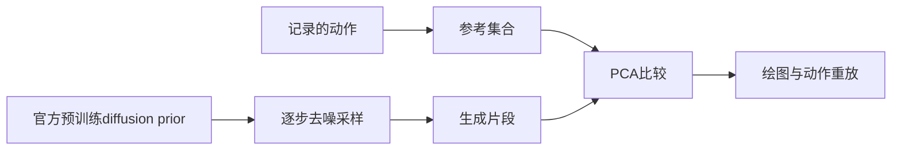

# Humanoid 回旋踢：PCA 揭示的冻结 SMP Prior 特征

**中文译版，英文为原版。** [English source](analysis.md) · [实验记录与播放命令](reproduce.zh-CN.md)

动作记录是一串身体姿态。本报告比较一段官方记录的回旋踢与一个已训练动作生成器产生的512个短片段。PCA提供统一的观察方式：哪些量在变化、少量成分能恢复多少，以及生成样本与原始记录有什么关系。报告还观察生成器逐步去噪时给出的中间估计。

本报告面向了解基础PCA、但可能刚接触动作数据、概率和机器学习的读者。建议先读阅读导引，再用G01–G02理解压缩、G08–G09理解分布、G10–G11理解去噪。GIF将测量结果与可见姿态联系起来。第6–7节保留解码与实现细节，供稍后查阅。

## 阅读导引

### A. 姿态、片段与运动的骨架

Humanoid是一套关节连接的骨架：多个刚体通过关节相连。**姿态（pose）**描述某一时刻的身体状态；**动作片段（motion clip）**是按时间排列的一串姿态。播放器读取数值化关节坐标，结合骨架计算身体位置，再把结果画出来。它播放的不是摄像机视频。

**自由度（DOF）**是关节允许的一个独立坐标。膝关节铰链有一个角度自由度，球形关节需要三个旋转坐标。当前资产有28个局部DOF。其 **root** 还描述整个身体的位置和朝向：移动root会整体移动角色，改变局部DOF则改变姿势。**正向运动学（FK）**利用已知的骨骼连接和长度，把root与关节坐标换算成身体位置。这项几何计算不会检验角色能否保持平衡，也不会检验它能否产生所需的力。

原生动作格式直接保存这些坐标。FPS表示每秒帧数。本报告中，十帧生成片段只是一段动作的局部，不是完整回旋踢。pose PCA比较单个姿态，window PCA还保留短序列内部的先后顺序。

### B. 观测点、分布与概率密度

设想从每一帧收集右膝角度，直方图就能显示哪些角度范围出现得更频繁。如果同时保留膝和髋两个角度，每帧就成为二维平面中的一个点。本报告的散点采用两个PCA系数，而不是两个指定关节角，因此能概括更多身体变化。

**分布（distribution）**描述观测或样本如何占据这个空间。对于有限集合，一个区域的经验概率就是落入其中的样本点比例。**密度估计（density estimate）**将离散点转为光滑曲面。概率是某个区域上的积分，而不是某个精确姿态处的曲面高度；这也解释了为什么概率密度轴带有单位。

需要区分三个对象：实际观测到的有限数据集、生成器学习表示的高维分布，以及对投影样本绘制的低维高斯/KDE估计。图中把第三个对象与第一个对象并列展示，并没有直接求生成器的完整概率密度。记录中动作较慢的部分可能贡献许多相似帧，因此一个区域更密集不一定表示动作更好。

### C. ML、DL、RL与动作先验

**机器学习（ML）**从示例中学习规律或模型参数。**深度学习（DL）**使用具有多层可学习结构的神经网络，本报告的动作生成器就属于这一类。PCA也从数据拟合表示，但这里直接通过矩阵分解方法——奇异值分解（SVD）计算，不训练神经网络。**强化学习（RL）**通过交互与奖励学习决策规则。RL可以使用深度网络，但不是DL之后必经的下一阶段。这些区分可参考[《Deep Learning》入门章节](https://www.deeplearningbook.org/contents/intro.html)和[Sutton、Barto的RL教材](https://mitpress.ublish.com/book/reinforcement-learning-an-introduction-2)。

**策略（policy）**把模拟角色的观测映射为控制动作，其动作通过物理过程影响下一状态。**动作先验（motion prior）**编码从示例学到的动作规律，可用于引导哪些运动应被偏好。**冻结（frozen）**意味着学习到的参数保持不变。本报告加载官方checkpoint，即此前学到的参数文件，用于采样，不再次训练这些参数。

### D. Diffusion生成与SMP的联系

diffusion模型训练时，会给干净示例加入不同程度的噪声，让网络学习去噪预测。生成时，则从新抽取的随机噪声开始，重复更新为有结构的样本。生成不要求先选中某条记录，再恢复那一条记录。本案例的50次去噪是推理步骤，不是训练轮数。这是[DDPM](https://arxiv.org/abs/2006.11239)中训练与采样的基本区分。

**SMP全称为Score-Matching Motion Priors。** 其框架通过分数蒸馏采样（score distillation sampling，SDS），利用冻结diffusion模型构造动作模仿奖励，再用该奖励训练控制策略。本案例观察的是prior直接采样，不是这一策略。参见[SMP论文](https://arxiv.org/abs/2512.03028)。

统计意义的 **score** 是一个向量，$s_t(x)=\nabla_x\log p_t(x)$，表示带噪动作密度在局部朝哪个方向增大。其中x是动作特征向量，$p_t$是噪声级别t下的动作密度，$\nabla_x$表示对这些坐标求导得到的向量。它不同于 **PCA score**：后者只是沿主成分的坐标。本报告图中采用的是PCA系数，没有绘制SMP奖励或diffusion的score向量场。



本报告使用三种不同操作：**采样**由生成器产生片段；**解码**把生成特征转换为原生动作坐标；**PCA重建**使用所选成分近似一个已有片段。密度曲面则是PCA投影之后单独进行的可视化。

## 主要发现概览

主要发现如下：

- 参考组与生成组的 pose PCA 压缩曲线相近。K=3时，累计解释方差分别为77.06%和77.49%。
- window PCA 对两组的区分更明显。参考组仅有30个窗口，数值秩为29；生成组有512个窗口，秩为280。这些秩描述的是当前数据与表示，不是质量评分。
- 在参考组前两个 PCA 坐标中，最终生成姿态主要沿参考轨迹分布。diffusion timestep 49的早期干净估计明显更分散。两项观察均不能证明物理有效性，也不能证明完整动作分布的覆盖程度。

这些结果来自冻结 prior 的直接采样。本轮没有训练、执行控制策略或进行远程操作。这是一份探索性案例报告，不是对 SMP 控制表现的独立评估。

## 1. 实验设计

本节明确一个数据点代表什么，以及哪些比较是有效的。实验使用已有记录和已训练生成器，然后进行离线分析，不学习新控制器。下表区分实际片段长度与拟合PCA所用的数值样本数量。

### 数据与采样

| 数据集合 | 片段数 | 每片段帧数 | FPS | 首末帧时间戳跨度 | pose 矩阵 | window 矩阵 |
|---|---:|---:|---:|---:|---:|---:|
| 官方源文件 | 1 | 78 | 60 | 1.28333 s | 分析前重采样 | 分析前重采样 |
| `reference` | 1 | 39 | 30 | 1.26667 s | 39 × 28 | 30 × 280 |
| `generated` | 512 | 10 | 30 | 0.30000 s | 5120 × 28 | 512 × 280 |
| 每个 `stage_*` | 512 | 10 | 30 | 0.30000 s | 5120 × 28 | 512 × 280 |

源数据为 `data/motions/humanoid/humanoid_spinkick.pkl`，checkpoint为 `data/models/smp_priors/smp_prior_spinkick.pt`。采样采用 EMA 权重、现有 DDPM scheduler的50步设置、seed 0和batch 64。模型权重没有复制到报告目录。

EMA（指数移动平均，exponential moving average）选择此前训练更新中平滑平均的权重。DDPM（去噪扩散概率模型，denoising diffusion probabilistic model）指这里的采样过程，scheduler负责规定噪声级别与更新规则。seed初始化随机数生成器，batch size控制同时处理多少个独立片段样本；二者都不是片段帧数。

参考动作通过 MimicKit 现有 `MotionLib` 插值在规则30 FPS网格上采样。不追加不规则末帧，因此实际分析时长略短。原始60 FPS文件保持不变。生成片段保留各自边界，不拼接成人工延长的完整回旋踢。

### 特征表示与重建

pose PCA将一帧的28个局部原生自由度（DOF）作为一个样本。window PCA将连续H=10帧展平为280个坐标，stride为1。每个片段内部单独切窗。因此，一个生成片段恰好贡献一个窗口，参考动作贡献30个重叠窗口。没有复制参考样本来匹配生成组的样本数。

两种模式均使用float64中心化SVD，不进行特征标准化或whitening。所选成分集合I的特征重建为：

```text
x_hat = mean + sum(score[k] * component[k] for k in I)
```

用数学记号表示，对特征向量$x_i$和所选成分集合I，有：

$$
z_{ik}=u_k^{\top}(x_i-\mu),\qquad
\hat{x}_i=\mu+\sum_{k\in I}z_{ik}u_k.
$$

其中，$\mu$是平均特征向量，$u_k$是单位主方向，$z_{ik}$是样本i在该方向上的系数。特征长度在pose模式为28，在window模式为280。这是坐标变换与近似，不是在给姿态分配概率。上面的代码表达式与此公式描述相同计算。

均值只添加一次。K=0表示不选取成分；在window模式下，它重建平均窗口，重叠平均后的序列不一定是静态姿态。窗口输出在各自片段内部进行等权重叠平均。

root的六个坐标不参与PCA，重建时直接保留。帧数、FPS和循环模式也保持不变。球关节DOF为指数映射坐标，不是彼此独立的Euler角。分析不展开旋转表示分支、不裁剪关节限位，也不放大成分系数。最终生成集合没有被标记为相邻DOF坐标跳变大于π的事件。

### 两类实验分别回答不同问题

| 实验 | 基底拟合方式 | 合适的用途 |
|---|---|---|
| 独立拟合 | 分别为参考组和生成组拟合各自的pose/window基底 | 压缩曲线、解释方差、载荷，以及相对于各片段自身输入的重建误差 |
| 共享参考基底 | 仅拟合参考组；使用相同均值与主成分投影参考组、最终样本和阶段估计 | 坐标、轨迹、直方图与投影密度比较 |

独立拟合模型的坐标轴不能互换使用。下文所有分布比较都采用共享参考基底。

独立拟合询问各集合在自身最合适的线性坐标中有多紧凑。共享基底询问两组位于同一套测量轴上的什么位置：在上面的投影公式中使用参考组的均值和方向即可。两幅独立拟合的散点图即使形状相似，也不能据此认定它们占据相同坐标。

RMSE是均方根误差：将差异平方后取平均，再开平方，因此较大误差的影响更强。DOF RMSE衡量原生坐标差异，单位为rad。FK RMSE为身体原点欧氏距离的均方根，单位为cm，使用MimicKit的float32 CPU正向运动学，对帧和身体等权。每个重建片段都与自身输入比较。两组没有逐帧配对或相位对齐，因此不计算参考动作与生成动作之间的逐帧“真值误差”。

## 2. 压缩与恢复的动作细节

本节研究只保留少量成分时，会丢失多少动作细节。每个集合都与压缩前的自身比较，检验的是PCA近似，而不是生成回旋踢是否匹配某一次具体记录。

### G01–G02：解释方差及重建误差随K的变化

横轴表示保留方向的数量K。G01中累计解释方差更高，意味着保留了更多数据的平方变化量，不是物理正确动作的百分比。G02中误差更低，意味着更接近该集合自身的坐标或身体位置。


部分K轴采用对数或symlog间距，以容纳完整秩范围；它们改变坐标间距，不改变K的取值。核心量为累计解释方差和重建误差：

$$
\operatorname{EV}(K)=\frac{\sum_{k=1}^{K}\lambda_k}{\sum_{j=1}^{d}\lambda_j},\qquad
\operatorname{RMSE}_{\mathrm{DOF}}=\sqrt{\frac{1}{TD}\sum_{i=1}^{T}\|\hat q_i-q_i\|_2^2}.
$$

特征值$\lambda_j$是第j个主方向上的方差；d是特征长度，T是总帧数，$D=28$为局部DOF数量。向量$q_i$与$\hat q_i$分别为输入和重建的局部DOF，单位rad。window的EV在重叠平均前计算，RMSE在恢复后的帧上计算。

$$
\operatorname{RMSE}_{\mathrm{FK}}=100\sqrt{\frac{1}{TB}\sum_{i=1}^{T}\sum_{b=1}^{B}\|\hat p_{ib}-p_{ib}\|_2^2}.
$$

$p_{ib}$与$\hat p_{ib}$分别是输入和重建的FK身体原点，单位m；B是身体数量，100将结果换算成cm。两者使用相同root。FK让误差具有可理解的空间含义，但仍不衡量力或平衡。

K扫描使用0、1、2、3、4、8和全部保留成分，限制在数值秩内并去重。窗口解释方差在展平的特征空间中计算；DOF和FK误差在重叠窗口合并后计算。

| 独立拟合组 | 秩 | K=3解释方差 | K=3 DOF RMSE | K=3 FK RMSE | K=8 FK RMSE |
|---|---:|---:|---:|---:|---:|
| reference / pose | 28 | 77.06% | 0.1804 rad | 12.50 cm | 2.84 cm |
| generated / pose | 28 | 77.49% | 0.1766 rad | 12.94 cm | 2.80 cm |
| reference / window | 29 | 80.24% | 0.1525 rad | 8.84 cm | 1.84 cm |
| generated / window | 280 | 74.27% | 0.1887 rad | 12.20 cm | 3.14 cm |

表格的主要实际含义是：三个成分可以恢复大体的协调变化，但仍保留可见的局部差异；八个成分则明显降低身体位置误差。数值秩是中心化样本中不可忽略的独立方向数。30个窗口样本经过中心化后，最多只有29个独立样本方向，这有助于理解参考窗口的秩。

pose曲线表明，在当前坐标表示下，两组的主要方差结构相近。低K时，生成窗口比参考窗口更难压缩。样本量、相位覆盖及参考窗口的重叠采样方式均有区别，因此不能仅凭秩的差异认定存在更多有用的动作多样性。

使用各集合自身模型进行全秩重建，可以在浮点精度内恢复保存的DOF；已检查的最大绝对误差低于4 × 10⁻¹⁵。相反，生成窗口通过全部29个参考窗口成分投影后，仍有 **0.09654 rad的DOF RMSE与5.23 cm的FK RMSE**。未见窗口可能位于参考子空间之外。参考pose基底已经覆盖全部28个姿态坐标，因此其全成分投影没有同样的维数限制。

### G03–G04：整体方差指标可能掩盖的局部细节

这些面板定位剩余误差。G03横轴是片段时间，纵轴是一个关节坐标，应在同一面板内把每条重建曲线与完整动作曲线比较。G04横向为时间，纵向为DOF编号，颜色为$|\hat q_{ij}-q_{ij}|$，单位rad。更亮的单元格表示该帧该坐标的近似误差更大，不是概率更高或物理作用力更强。


G03跟踪DOF17（`right_knee`，铰链角）和DOF8（`right_shoulder.z`，参考组中方差最大的坐标，属于指数映射分量）。K=1/2/3均保留均值与累计成分贡献。即使整体解释方差已经较高，低秩重建仍会遗漏膝关节的剧烈变化。时间轴属于各片段自身，参考组与生成组没有相位对齐。G04的四个面板共用误差色标，同时保留各片段的实际时间范围。

以下GIF采用独立pose拟合。每格都是一个独立片段，没有把生成样本延长为完整回旋踢。

| 参考完整动作 | 参考K=1 | 参考K=2 | 参考K=3 |
|---|---|---|---|
|  |  |  |  |

| 生成片段0完整动作 | 生成片段0，K=1 | 生成片段0，K=2 | 生成片段0，K=3 |
|---|---|---|---|
|  |  |  |  |

## 3. 坐标、载荷与时间结构

本节研究降维坐标代表什么。**载荷（loading）**描述一个成分在不同关节坐标上的模式；**系数（score）**描述该模式对某个姿态或窗口贡献多少。一个成分可以同时协调多个关节，不必对应“踢腿”这样的命名动作。

G05可在一个成分内部比较颜色的正负与大小：相反符号意味着坐标沿该轴朝相反方向贡献。大载荷表示在该单位方向中参与较强，不能单独代表方差大小。G06可沿连线观察时间变化，G07则把时间保留为显式坐标轴，而不是压缩成第三个PCA坐标。


G05使用独立基底。pose面板中每行是一个成分，每列是一个DOF。每个window面板包含三个成分区块，每块有28个DOF列和10个时间行，没有沿时间平均载荷。颜色表示单位范数主成分的无量纲载荷。为便于复现，将每个成分绝对值最大的载荷指定为正；这一规则不会让两组的主成分自动对齐。


G06采用参考pose模型的PC1、PC2和PC3系数，单位为rad。点表示姿态，连线遵循片段内部时间顺序，黑方块表示起点。生成片段0–3分别占据参考轨迹的不同局部区间，并非完整循环。第三轴仍然是坐标，不是概率。


G07改用x轴表示时间（s），y轴表示DOF17，z轴表示DOF8（rad）。它回答动作随时间如何变化的问题，不添加缺乏依据的概率轴。两面板共用DOF范围，同时保留不同的实际时长。

## 4. 从投影样本到密度曲面

这里的问题从重建某条具体片段，转为描述大量姿态或窗口出现在哪里。建议先看G08的实际样本点，再看G09的光滑概括。投影模式相似，只能说明这些坐标上的情况；不同高维动作在投影后也可能重叠。


G08比较的是共享PC系数，而不是方差。一个pose点表示一帧，一个window点表示十帧片段。pose与window模型定义的是不同坐标空间。两组直方图共用bin并按面积归一化，因此样本总数不会直接决定柱高。均匀时间采样的参考帧描述了经验姿态占用分布。生成片段内部的帧存在相关性，5120帧不等于5120个独立动作。


G09中，**x与y是PC1、PC2系数，z是这个二维投影的概率密度**，单位为1/rad²。曲面高度不是某个姿态的概率；区域概率需要积分。参考观测与生成样本都可以用于密度估计。

KDE（核密度估计，kernel density estimation）在每个投影点放置一个小的光滑凸起，再对这些凸起求平均：

$$
\hat p(z)=\frac{1}{N}\sum_{i=1}^{N}\mathcal N(z;z_i,\Sigma_h),\qquad
\Pr(z\in A)\approx\int_A\hat p(z)\,dz.
$$

其中$z=(z_1,z_2)$是共享PCA平面上的一个位置，$z_i$是一个观测投影点，N是点数，$\Sigma_h$是共用核协方差。$\mathcal N(z;z_i,\Sigma_h)$表示以$z_i$为中心、归一化的高斯凸起，A是平面上的一个区域。矩阵$\Sigma_h$控制平滑程度，与窗口长度H不同。宽核会合并相邻结构，窄核更强调单个观测。系数1/N使总概率质量为1，不受组内样本数影响。

G09的曲面高度与等高线颜色表示相同的密度量。高斯面概括一个整体中心与范围，KDE则可以保留多个集中区域。二者是否一致，描述的是所选估计方法，而不是哪个生成器本质上更好。

高斯模型使用各组拟合的均值和最大似然协方差。它概括中心与范围，同时会平滑掉环形或多峰结构。KDE是等权高斯核混合；核协方差只在参考组上根据Scott规则确定一次，然后原样用于生成组和全部阶段。其对角近似为：pose的(0.52821, 0.26933) rad²，window的(6.10368, 3.21882) rad²。高斯模型拟合的协方差是模型参数，不是这里的KDE带宽。

每组比较使用相同网格、曲面高度范围与色标。密度在整个平面上积分为1，不对显示矩形重新归一化。实现已通过SciPy参考KDE及大范围数值积分核对。G08的散点轨迹明显比曲面细，提醒我们：KDE填出的区域可能来自平滑，而不是实际观测到或成功生成的动作。

以下四个完整短片段将投影轨迹、密度与可见动作联系起来：

| 片段0 | 片段1 | 片段2 | 片段3 |
|---|---|---|---|
|  |  |  |  |

## 5. 去噪快照：干净估计，而非原始噪声

本节跟踪一次采样过程，而不是比较训练程度不同的模型。所有阶段使用同一个冻结网络。物理时间沿每个GIF内部的帧推进，diffusion timestep则表示对整个片段重复细化的步骤。因此，从t=49到t=0不是角色随时间做出的下一步动作。

记录的timestep为49、39、29、19、9、0。**timestep 49是第一次反向去噪的输入，不是第49次反向迭代。** 缓存同时保存所选阶段的归一化输入x_t和预测干净结果x₀。图与播放片段使用后者，经反归一化与动作解码后得到；它们不展示原始x_t分布。各阶段保持sample ID一致，timestep 0的干净估计与最终输出逐位相同。


对于checkpoint采用的噪声预测设置，去噪关系为：

$$
\begin{aligned}
 x_t &= \sqrt{\bar\alpha_t}x_0+\sqrt{1-\bar\alpha_t}\,\epsilon,\quad \epsilon\sim\mathcal N(0,I),\\
 \hat x_0^{(t)} &= \frac{x_t-\sqrt{1-\bar\alpha_t}\,\epsilon_\theta(x_t,t)}{\sqrt{\bar\alpha_t}}.
\end{aligned}
$$

本小节的x表示归一化的生成特征窗口，不是前面原生DOF的PCA向量。$x_0$是干净特征窗口，$x_t$是其带噪状态，$\epsilon$是协方差为单位矩阵I的标准高斯噪声，$\bar\alpha_t$为scheduler保留的信号比例，$\epsilon_\theta$是参数$\theta$固定的神经网络所预测的噪声。生成时真正的干净窗口未知，$\hat x_0^{(t)}$是当前估计。第一式描述加噪，第二式解释scheduler保存的干净估计；完整DDPM更新还会构造下一带噪状态。这些公式说明现有采样器的背景，没有在报告中新增计算。参见[DDPM的训练与采样表达](https://arxiv.org/html/2006.11239v2)。

保留信号较小时，预测噪声的误差可能放大为干净估计的较大误差。这有助于解释t=49 GIF的异常跳动：早期旋转特征可能远离一致的姿态，直接解码没有加入平滑或接触修复，而短片段循环会突出突变。它是一份供检查的早期估计，不能当作完成的可用动作，也不表示训练仍在进行。

用相同尺度从早期到后期阅读G10，并利用G11的点云检查平滑是否遮蔽异常点。观察到的是向参考动作区域靠近的变化，不是对策略的数值评估，也不是精确似然。

G10用白圈叠加参考观测，用红色标记片段0。window模式下，片段0只有一个点。G11保留每个投影样本，参考点为蓝色，阶段估计为橙色。各阶段比较共用参考基底、坐标范围、KDE核与密度色标。

最初的干净估计比较分散，可能解码出不合理姿态。后续估计逐渐接近观测动作区域。密度更尖锐本身不是质量指标，diffusion timestep也不是角色运动的物理时间轴。以下每个GIF分别播放同一片段0的一份0.3 s估计：

| t=49 | t=39 | t=29 |
|---|---|---|
|  |  |  |

| t=19 | t=9 | t=0 |
|---|---|---|
|  |  |  |

## 6. 解码、显示与证据的边界

本节解释数值与GIF实际保留了什么。解码改变生成片段的表示形式，PCA重建改变保留多少片段变化量，它们是不同操作。冗余关键位置/速度特征用于检查内部是否一致，不是衡量相对于某个不存在的生成真值动作的距离。

从几何上说，$p_b=\operatorname{FK}_b(\rho,q)$：root姿态$\rho$和局部DOF q结合骨架，确定身体b的位置。播放器设置这些姿态用于绘图，不要求控制器通过施力产生它们。固定显示root类似将角色底座放在固定支架上：便于观察姿势，同时抑制整体位移与转身。

解码前，反归一化会恢复训练特征的均值和尺度，让数值回到其坐标单位。这项diffusion预处理，与PCA不标准化原生DOF的选择是两件事。

同一个旋转可以采用不同数值编码。三个指数映射坐标共同编码旋转轴与角度；六维编码采用两个方向向量，理想情况下长度为1且彼此垂直。生成向量，特别是早期估计，可能不满足这些条件。Gram–Schmidt可对这些向量做正交化，但本案例保留仓库原有解码，没有额外加入这项修复。仅仅改变编码形式不能证明动作在物理上有效。

每个生成帧包含114个特征：root位置3维、root六维旋转6维、十四个关节的六维旋转84维、五个关键身体的root相对位置15维，以及root线速度/角速度6维。原生动作帧保存34个坐标：root位置3维、root指数映射3维、局部DOF28维。解码复用 `tan_norm_to_quat` 和 `rot_to_dof`，保持训练序列从过去到当前的顺序，不添加Gram–Schmidt投影、限位修正或接触修复。

完整原始特征仍然保留。关键位置和速度不是原生动作文件中的独立字段，因此114维到34维的解码不是可逆无损转换。最终样本的原始关键位置与解码后FK关键位置约有 **3.29 cm RMSE**。root位置前向差分与相邻预测速度中点值的坐标差异约为 **0.129 m/s RMSE**，其中也包含有限差分近似误差。详见[解码诊断](assets/data/decode_diagnostics.json)。

17段GIF均通过Newton实际渲染，隐藏UI且只显示一个角色。它们共用镜头、固定裁剪框、root朝向、水平位置与参考高度，保留局部旋转。输出为520 × 520。帧采样严格为30 FPS；GIF时间量化为10 ms，使用30/40 ms停留时间。39帧参考动作的时间戳跨度为1.26667 s，包含末帧停留后的循环为1.30 s；十帧片段跨度为0.30 s，编码循环为0.33 s。重新开始时的跳变是播放边界，不是生成的过渡动作。

固定root会从显示中移除整体转身、位移和垂直运动。脚滑、悬空或穿插不应被理解为经过接触修正的物理效果。交互 `comparison` 视图恢复原生root运动；`classroom` 在完整局部动作下方展示累计K=1/2/3重建。

本案例只有一段参考记录，没有独立测试动作集、置信区间或物理控制评估。参考窗口重叠采样与生成起始相位也有区别。低维曲面不能描述完整高维分布，在之前为空的投影区域中出现样本也不能证明生成质量更好。接入策略轨迹前，可先比较多个seed、按片段重采样的区间估计，以及更多参考动作。

## 7. 实现与已记录的验证

最后一节记录如何找到并检查结果。保存的PCA模型包含均值与主方向，集合快照还保留源帧、系数与窗口边界。缓存复用这些已验证文件，避免重复计算。哈希用于识别文件内容，防止输入或模型变化后仍被静默当作同一个实验。

下面流程图是实现地图，不是学习算法或新增科学结果。只关注动作发现的读者可以返回图表；需要复现的读者可结合播放文档查阅。

```text
run_smp.py -> smp/sampling.py
  TinyMDM + EMA + 现有DDPM -> 可选阶段回调
  -> 反归一化 -> 现有旋转解码 -> 采样特征与原生帧

prepare_case.py -> workflows/spinkick.py
  data/resampling.py -> core/collection.py 独立拟合与共享投影
  -> analysis.json + 去重的模型、帧与投影快照

play_analysis.py -> core/collection.load_collection() -> for_clip()
  -> AnalysisSession.reconstruct(indices) -> player/environment.py
  -> 动画插值 -> 仅显示层的root变换 -> MimicKit FK -> Newton/Warp

case_plots.py -> reporting/metrics.py、density.py、plots.py
case_gifs.py  -> reporting/gifs.py -> 固定镜头逐帧渲染与裁剪
```

PCA数学、成分选择与重叠平均属于 `core/`；原生数据与原子持久化属于 `data/`；公共路径位于 `paths.py`。采样不依赖PCA session写入资产。顶层命令保持稳定，`smp/`、`player/`、`reporting/` 和 `workflows/` 分别承担不同职责。

采样缓存身份包含模型/配置/环境/角色哈希、seed、batch、EMA、设备与处理版本。有效的准备缓存同时避免推理和SVD。播放器读取已验证快照，缺少拟合结果时不会静默重新计算。生成资产保留本地并由Git忽略，英文原版与中文译版纳入版本控制。

已记录的实现验证使用 `mimickit-newton`：67项motion/PCA/CLI测试与9项采样/案例缓存测试通过，普通测试中跳过两项opt-in GL测试。另行启动的原生窗口覆盖reference/pose、generated/window和stage_49/pose，包括视图切换、暂停、成分更新、单步、重启与关闭。阶段回调没有改变普通EMA输出或RNG状态。512样本资产通过有限值、形状、边界、全成分重建与缓存检查。17图和17段GIF已审查，29条播放示例已核对不会采样或执行SVD。这些是已记录的实现检查，并非本次文档编写中新测得的科学性能结果；详见[validation.json](assets/data/validation.json)。

### 相关可视化选择

这些参考资料解释报告为什么使用压缩曲线和低维动作轨迹。下文提到的GPLVM与GPDM是相关文献中的非线性潜变量模型，不是本实验额外拟合的模型。阅读当前PCA结果不要求理解它们的算法。

- [Safonova、Hodgins、Pollard，SIGGRAPH 2004](https://graphics.cs.cmu.edu/nsp/papers/sig04.pdf)：低维动作表示与误差随维数变化的图示，为G01–G02提供参考。本案例未实现论文的物理优化。
- [Wang、Fleet、Hertzmann，TPAMI 2008](https://www.dgp.toronto.edu/~jmwang/gpdm/pami.pdf)：Fig.3(a)展示行走轨迹的三维PCA初始化。G06只使用线性PCA，不把GPDM置信度可视化当作本案例的密度估计。
- [Urtasun等，CGF 2004](https://www.cs.toronto.edu/~urtasun/publications/urtasun-etal-cgf04.pdf)：Fig.4展示速度与时间离散动作向量的主成分系数之间的关系。当前短窗口表示并不是该整周期风格模型。
- [SMP](https://arxiv.org/abs/2512.03028)：冻结动作diffusion prior为下游控制提供score/SDS引导。本报告的直接prior播放不同于该工作研究的策略执行。

G09的高斯与KDE曲面是本案例增加的解释性视图，并非对这些论文实验的复现。
